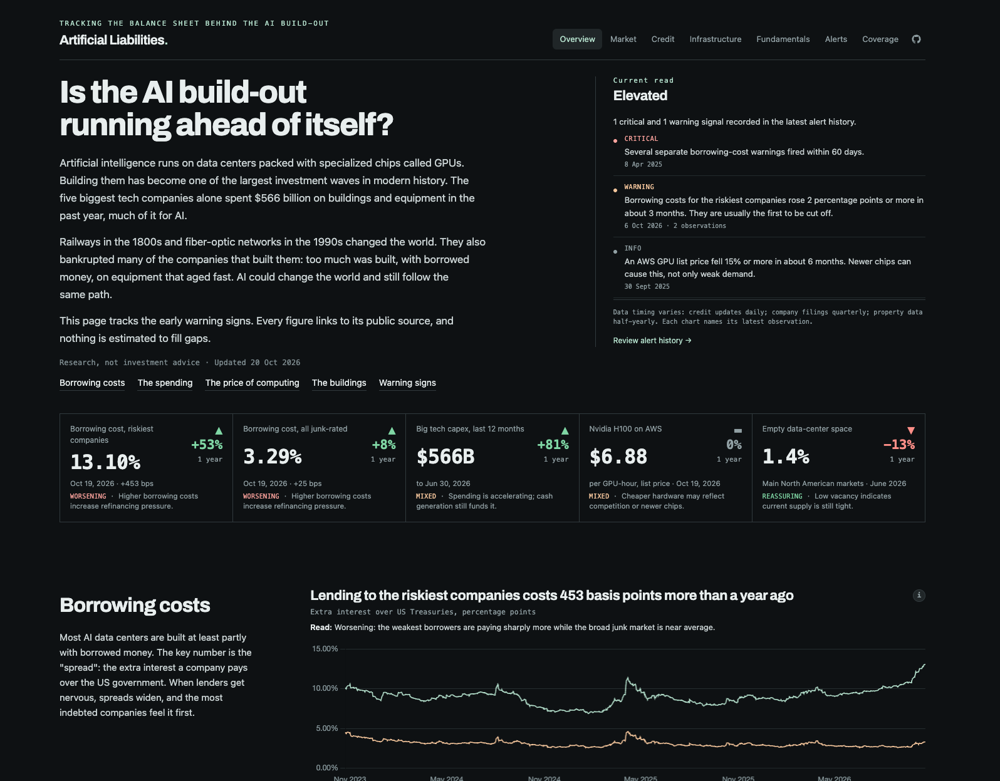

# Artificial Liabilities



A research dashboard for one question: is the AI infrastructure build-out
creating unsustainable overcapacity, leverage, and credit risk? It tracks nine
indicators across GPU economics, credit, physical supply, and company
fundamentals, with source-level provenance and freshness on every series.

**Rules it follows:** values are never invented or interpolated. Derived
figures are labeled "calculated". Stale data is never shown as current.
Sources whose terms forbid automated collection are not used.

## Run locally

```bash
pnpm install
cp .env.example .env
pnpm db:migrate
pnpm collect all --backfill
pnpm dev
```

For local configuration, operating procedures, checks, scheduled workflows,
and deployment, see [AGENTS.md](AGENTS.md).

## Docs

- [Architecture](docs/architecture.md): layers, collectors, error handling, freshness.
- [Data model](docs/data-model.md): tables, vintages, derived metrics.
- [Coverage](docs/coverage.md): what each indicator can and cannot show, and why.

Research dashboard, not investment advice.
